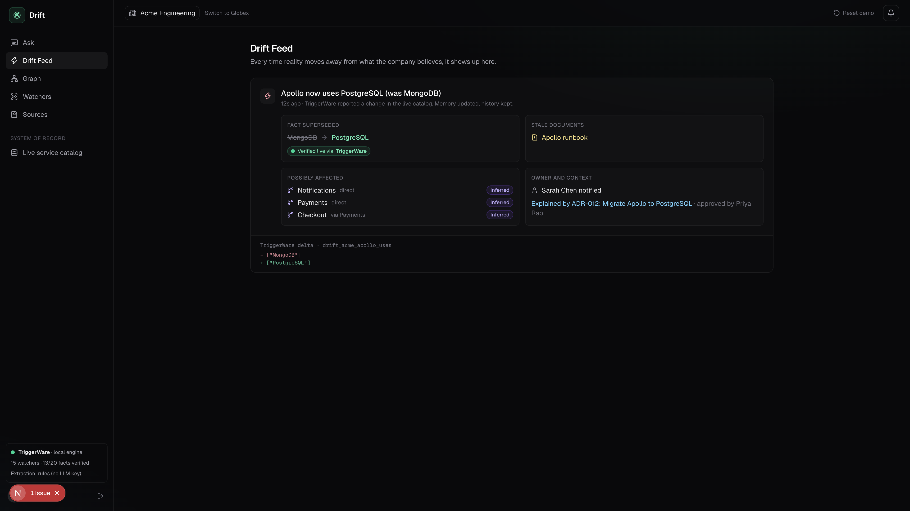

# Drift

**The Company Brain that notices when it is wrong.**

Company knowledge goes stale quietly. A runbook says Apollo uses MongoDB weeks after the team moved it to PostgreSQL. Search finds that page instantly, AI assistants repeat it with confidence, and AI memory only changes its mind when someone corrects it. Nobody is checking.

Drift turns company docs, decisions and chat into facts that know where they came from and when they were true. It then keeps checking those facts against the live systems that run the company, using [TriggerWare](https://triggerware.com). When reality changes, Drift updates its memory without erasing history, flags the documents that are now wrong, traces what depends on the change, and alerts the owner.

## Demo video

[](https://drive.google.com/drive/folders/11J1VTVw5fEVi8qOsLPngXkIRH4_iZZZu?usp=sharing)

**[▶ Watch the demo on Google Drive](https://drive.google.com/drive/folders/11J1VTVw5fEVi8qOsLPngXkIRH4_iZZZu?usp=sharing)** · [download from this repo](docs/Drift-demo.mp4)

## How it works

1. **Learn.** Docs, decision records (ADRs) and chat are turned into facts, each with a source, a trust level and a time range. Small talk, secrets and unverified guesses are dropped.
2. **Watch.** Every fact Drift can check becomes a TriggerWare trigger: a scheduled SQL query against the live system of record.
3. **Detect.** When the live value changes, TriggerWare pushes only the rows that changed.
4. **React.** Drift supersedes the old fact and keeps it as history, marks documents that still repeat it as stale, walks the dependency graph to find what might break, and alerts the owner.

Every line of an answer is labelled with how Drift knows it:

| Label | Meaning |
| --- | --- |
| Verified | Checked live against the system of record |
| Stale | A document still says something that is no longer true |
| Decision | Comes from a decision record |
| History | Used to be true, with the dates it was true |
| Inferred | Drift's best guess, never presented as fact |

When sources disagree, the more authoritative one wins (live system, then ADRs, then docs, then chat). A weaker source that contradicts the live system is stale on arrival; anything else opens a conflict for a human.

## How Drift uses TriggerWare

- **Reads live systems as SQL.** The service catalog is a table Drift can query.
- **Detects change and pushes the delta.** One trigger per checkable fact, for example `SELECT datastore FROM service_catalog WHERE org = 'acme' AND service = 'apollo'`. Drift never scrapes or diffs.
- **Checks live, mid-answer.** Before answering, Drift re-runs that fact's query so the answer is current.

Without TriggerWare, each new source would need its own scraper and change detector. With it, a new source is one connector.

## Quick start

Requires Python 3.11+ and Node 20+.

```bash
./dev.sh
```

This creates the Python virtual environment and installs dependencies on first run, then starts the API on `127.0.0.1:8000` and the web app on [localhost:3000](http://localhost:3000). Log in as **Sarah Chen (Admin)**.

### Try it

1. On **Ask**, ask "What database does Apollo use?" Drift answers MongoDB, verified live.
2. Open **Live service catalog**, change Apollo's datastore to PostgreSQL, and click **Save**.
3. Click **Check now** to force the poll instead of waiting for the schedule.
4. A toast appears. Open **Drift Feed** to see the alert: stale runbook, affected services, owner.
5. Ask "Why did we move Apollo off MongoDB, who approved it, and what might break?"
6. On **Graph**, drag the time slider back to see what the company believed before the change.

**Reset demo** in the top bar restores the starting data.

## Configuration

Nothing is required. With no keys, Drift uses a built-in local TriggerWare engine, rule-based extraction and local embeddings.

| Variable | Purpose |
| --- | --- |
| `TRIGGERWARE_ADDRESS` | `host:port` of a TriggerWare server (for example local Docker) |
| `TRIGGERWARE_URL`, `TRIGGERWARE_API_KEY` | Hosted TriggerWare instead of an address |
| `TRIGGERWARE_SCHEDULE` | Poll schedule, default every minute (`*/1 * * * *`) |
| `ANTHROPIC_API_KEY` or `OPENAI_API_KEY` | LLM extraction and answer summaries |
| `NEXT_PUBLIC_API_URL` | API address for the web app, default `http://127.0.0.1:8000` |

## Deploy

The API needs a long-running process (TriggerWare polling, live event stream, SQLite file), so it runs on Render. The web app runs on Vercel.

1. **API on Render.** New → Blueprint → select this repo. `render.yaml` sets everything up. When asked for `DRIFT_CORS`, enter your Vercel URL (for example `https://drift.vercel.app`).
2. **Web on Vercel.** New Project → this repo → set **Root Directory** to `web` → add `NEXT_PUBLIC_API_URL` = your Render URL (for example `https://drift-api.onrender.com`).

On Render's free plan the API sleeps after 15 minutes idle and reseeds the demo data when it wakes, so the first request can take about a minute.

## Project layout

```
api/            FastAPI backend
  drift/        memory, extraction, TriggerWare watchers, answers, auth
  eval/         evaluation harness
  scripts/      go/no-go check and smoke test
web/            Next.js app: Ask, Drift Feed, Graph, Watchers, Sources, Catalog
dev.sh          starts both
```

## Evaluation

```bash
cd api && .venv/bin/python eval/run_eval.py
```

On the synthetic demo company:

- Questions answered correctly: 12 of 12 for Drift, 2 of 12 for a no-LLM search baseline
- Live changes detected: 9 of 9, with 0 false alerts
- Time from change to alert: about 2 ms on the local engine
- Durable-fact filter: precision 1.00, recall 1.00
- Tenant isolation: another org's data returns 404

The questions and the demo company were written by us, so treat these as a sanity check rather than a benchmark.

## Status

Built for the Company Brain Hackathon 2026. The demo company, its documents and its catalog are synthetic. The demo runs on the built-in local TriggerWare engine; the adapter for a real TriggerWare server is written but has not yet been tested against one.
